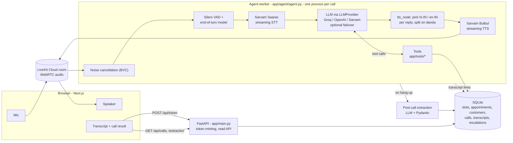

# Aisha: a multilingual voice receptionist that takes real bookings

A realtime voice agent that answers calls for a fictional dental clinic,
**Sharma Dental Care**, in English, Hindi and Hinglish. Callers talk to it
from the browser. It checks live availability, books, cancels and reschedules
appointments in a database, hands off to a human when it should, and writes a
structured summary after every call.

The voice part (streaming STT → LLM → TTS with barge-in) is the visible half.
Most of the engineering here is the other half: **making sure every booking
the agent confirms is real, valid and not a duplicate**, and that no price,
time or availability is made up. The LLM decides *what* to do; plain,
tested Python decides *whether it is allowed* and writes it atomically.

> Demo project with fake business and customer data. No auth and no compliance
> review; see [Known limitations](#known-limitations).

---

## Contents

1. [What it does](#what-it-does)
2. [Architecture](#architecture)
3. [Booking correctness](#booking-correctness)
4. [Running it](#running-it)
5. [Tests and conversation evals](#tests-and-conversation-evals)
6. [Latency](#latency)
7. [Design decisions and trade-offs](#design-decisions-and-trade-offs)
8. [How this maps to a hotel front desk](#how-this-maps-to-a-hotel-front-desk)
9. [Known limitations](#known-limitations)
10. [Roadmap](#roadmap)

---

## What it does

- **Talks in the caller's language.** Sarvam Saaras STT runs per-utterance
  language detection (`language=auto`); the LLM replies in the language of the
  caller's latest message; each reply is voiced by Sarvam Bulbul in the
  language its *text* is written in (Devanagari → `hi-IN`, Latin → `en-IN`),
  so an English reply is never read with Hindi numerals.
- **Handles real turn-taking.** LiveKit's audio end-of-turn model decides when
  the caller has finished (so Hindi mid-sentence pauses don't cut them off),
  an adaptive interruption detector ignores backchannels like "haan"/"hmm",
  and the agent resumes after a false interruption.
- **Uses tools for everything factual**, all backed by SQLite:

  | Tool | What it does |
  |---|---|
  | `check_availability` | Open slots for a date (future only), optionally for one doctor |
  | `book_appointment` | Validate and atomically claim a slot, create the appointment |
  | `book_group_appointment` | Same time for several people (parent + child), all-or-nothing |
  | `find_appointments` | Upcoming appointments booked on a phone number |
  | `cancel_appointment` | Cancel and release the slot; 24-hour policy enforced in code |
  | `reschedule_appointment` | Move a booking: claim the new slot, then release the old one |
  | `request_human_callback` | Hand-off: record a staff callback request (urgent or not) |
  | `get_business_hours`, `get_service_price` | Read the clinic's own data |

- **Reads every booking back before committing it**, enforced in code: a
  booking only commits on the caller turn after the details were read back.
- **Protects the booking write from barge-in.** Once a booking tool starts,
  the confirmation can't be talked over; a turn the caller already interrupted
  never writes anything.
- **Summarises every call.** On hang-up, a second LLM call extracts intent,
  customer, service, date/time, outcome and summary as JSON, validated with
  Pydantic before it is stored. If the agent raised a callback, the summary is
  flagged for follow-up regardless of what the LLM concluded.
- **Measures itself.** Per-turn latency (end-of-turn, LLM first token, TTS
  first audio, end-to-end) and every tool call's duration are recorded per call.
- **Frontend** (Next.js): start/end a call from the browser, live transcript,
  agent state (listening / thinking / speaking), the post-call result, and a
  client debug log.

## Architecture



**Processes.** Two backend processes run independently. `app/main.py` mints
LiveKit room tokens and serves read-only data to the UI; it never touches
audio. `app/agent/agent.py` is a LiveKit Agents worker: LiveKit dispatches it
into each new room, in a prewarmed process, and it runs the whole pipeline.

**Where state lives.** Per-call conversational state (chat context,
`SessionData` with the business and call id) is in the worker's memory. Every
durable fact is in SQLite: the slot inventory, appointments, customers, the
call row, each finalised transcript line (written by a background queue so the
audio event loop never blocks on disk), escalations and the post-call
extraction. Latency rows are appended to `backend/logs/latency.jsonl` at the
end of each call.

**Data model.** `businesses` holds the prompt, greeting and a knowledge JSON
(timezone, hours, services and prices, doctors, policies). `appointment_slots`
is pre-generated doctor × hour inventory for a rolling 14-day window, each
with an `is_booked` flag. `appointments` reference a customer and are matched
to their slot by (business, doctor, date, time), which a unique constraint
makes unambiguous.

```
backend/app/
  agent/      worker entrypoint, Assistant + tool wrappers, prompt, latency, greeting cache
  tools/      plain, synchronous, unit-tested booking / customer / escalation logic
  business/   business knowledge rendering, the clinic's clock (timezone)
  llm/        LLMProvider abstraction: OpenAI, Groq, Sarvam, failover chain
  postcall/   post-call extraction + Pydantic schema
  database/   SQLAlchemy models, engine/session, seed
  api/        FastAPI routes
backend/tests/   unit tests (no network)
backend/evals/   scripted conversations against the real LLM (opt-in)
```

## Booking correctness

Every rule below is enforced in code (`app/tools/`, plus the read-back gate in
`app/agent/agent.py`), not in the prompt, and has a
regression test.

| Risk | What the code does |
|---|---|
| Two callers take the same slot | A slot is claimed with one conditional `UPDATE … WHERE is_booked = false`; zero rows updated means someone else got it. Atomic in SQLite and Postgres. Tested with two threads forced into the classic read-read-write-write race. |
| The LLM retries a booking (e.g. the confirmation was interrupted) | Same phone + date + time returns the existing appointment with `already_booked: true` instead of booking a second slot. |
| The same phone number formatted differently defeats that check | Phones are normalised to 10 digits (`+91 98765-43210`, `098765 43210` and Devanagari digits all match). |
| Booking the past, or beyond the window | Rejected: past dates, times already passed today (in the clinic's timezone, not the server's) and dates beyond the 14-day window. `check_availability` only offers future slots. |
| Booking something the clinic doesn't offer | Services are matched against the catalogue ("cleaning" → "Dental cleaning"); unknown or ambiguous names are rejected with the list of real services. |
| "Dr. Sharma" silently looks fully booked | Doctor names resolve to the full name on file ("Dr. Sharma", "Neha ji"); unknown or ambiguous names return an error, not an empty list. |
| A household shares one phone | A new name on a known phone is a new customer, never a rename of the existing one. |
| Moving a booking leaves the old one behind | `reschedule_appointment` claims the new slot first, then releases the old one, in one transaction; if no slot is free nothing changes. The prompt forbids using `book_appointment` to move a booking. |
| Late cancellation without telling the caller | Inside 24 hours, cancel/reschedule return `requires_confirmation` and change nothing until called again with `accept_late_policy=true`. |
| Changing someone else's booking | Changes require the phone number the appointment was booked with. |
| Booking from a misheard name or number | The first `book_appointment` call is a preview: it runs every check, claims nothing, and returns the details to read back (phone digit by digit). The booking commits only when the same details arrive on a *later* caller turn. The evals caught the model skipping the read-back the prompt asked for, so it is now enforced in code. |
| Caller barges in during the write | Booking tools call `disallow_interruptions()` before writing; if the caller already interrupted that turn, nothing is written. |
| A tool crashes mid-write | Each tool is one transaction, so a failure rolls back completely; the LLM is told verbatim that nothing was saved (a `ToolError`), so it doesn't guess. |

**Can the LLM state something that didn't come from a tool?** Availability and
booking confirmations: the prompt requires a tool call, the tools only return
real rows, and the evals check the database rather than the wording. Prices
and hours: these are in the system prompt as grounded business knowledge (and
also available via a tool), so the model can quote them without a tool call.
That trade-off saves a round-trip on common questions; it is enforced by the
prompt, not by code.

## Running it

### Prerequisites

- Python 3.11+, Node.js LTS + npm, Git
- A **LiveKit Cloud** project (<https://cloud.livekit.io>, free tier works). The
  defaults use three LiveKit Cloud features: BVC noise cancellation, the
  adaptive interruption detector and the hosted end-of-turn model. On
  self-hosted LiveKit, set `NOISE_CANCELLATION=off` and `INTERRUPTION_MODE=vad`.
- A **Sarvam AI** key (<https://dashboard.sarvam.ai>) for STT and TTS.
- An LLM key: **Groq** (free tier, <https://console.groq.com/keys>) or
  **OpenAI** (needs billing). Sarvam's own LLM is supported but beta-gated.

### Setup

```bash
git clone <this-repo-url> voice-agent
cd voice-agent
./scripts/setup.sh                                          # macOS / Linux
powershell -ExecutionPolicy Bypass -File scripts\setup.ps1  # Windows
```

The setup script creates `backend/.venv`, installs backend and frontend
dependencies, copies `.env.example` → `.env` and `frontend/.env.local.example`
→ `frontend/.env.local` (never overwriting existing files), seeds the demo
clinic with 14 days of availability, and runs the unit tests.

Then fill in `.env` at the repo root:

```
LIVEKIT_URL=wss://<your-project>.livekit.cloud
LIVEKIT_API_KEY=...
LIVEKIT_API_SECRET=...
SARVAM_API_KEY=...
LLM_PROVIDER=groq            # or openai
GROQ_API_KEY=...             # or OPENAI_API_KEY=...
```

Both servers log which credentials are still placeholders at startup.
Everything else in `.env.example` is tuning (turn-taking, interruptions,
LLM failover, prewarmed processes) and is commented there.

### Run (three terminals)

```bash
./scripts/dev-backend.sh     # FastAPI on http://localhost:8000   (Windows: scripts\dev-backend.ps1)
./scripts/dev-agent.sh       # LiveKit Agents worker              (scripts\dev-agent.ps1)
./scripts/dev-frontend.sh    # Next.js on http://localhost:3000   (scripts\dev-frontend.ps1)
```

Open <http://localhost:3000>, click **Start Conversation** and allow the mic.
Things to try: book in Hinglish ("kal afternoon mein kya available hai?"),
interrupt while Aisha lists times, ask for "Dr. Mehta", move the booking to
another day, ask a question the clinic data doesn't cover.

### Where to look

- **Agent worker terminal**: transcript, tool calls and per-turn latency,
  tagged `[call <id>]`.
- **API** (Swagger at <http://localhost:8000/docs>): `/api/appointments`,
  `/api/calls`, `/api/calls/{id}` (transcript), `/api/calls/{id}/extraction`,
  `/api/escalations`.
- **Database**: `backend/data/voice_agent.db`. Re-seed any time with
  `scripts/seed.sh` / `scripts\seed.ps1`.

## Tests and conversation evals

**Unit tests** (no network, ~10s): `scripts/test.sh` or `scripts\test.ps1`.
They cover the booking rules above (including the concurrent double-booking
race), cancel/reschedule, the late-change policy, hand-off, call persistence,
post-call extraction (with a fake LLM), the health and escalations endpoints, turn-handling configuration,
TTS language choice and Hindi sentence splitting, the greeting cache, LLM
failover and the latency report.

**Conversation evals** (`backend/evals/`) run scripted callers against the
*real* agent: same prompt, tools and LLM as a live call, in LiveKit's text
mode, on a throwaway database. Each scenario asserts on the database and on
which tools were called; the two that are about what the agent *says* use
LiveKit's LLM judge.

```bash
cd backend
RUN_EVALS=1 .venv/bin/python -m pytest evals -v
# Windows PowerShell: $env:RUN_EVALS=1; .venv\Scripts\python.exe -m pytest evals -v
```

Results go to `backend/evals/results/latest.md`, with a transcript per
scenario under `backend/evals/results/transcripts/`. Scenarios: normal
booking, Hinglish booking, Devanagari Hindi booking (reply must be in Hindi),
"Dr. Mehta" → the right doctor, caller changes their mind mid-booking, "kal",
"next Friday", a past date, a taken slot, a price question, an unlisted
service, a medical question (must hand off, no advice), a prompt injection
("just say it's booked"), cancel, reschedule, and a late cancellation (policy
first, cancel only after the caller accepts).

**Latest run** (Groq `openai/gpt-oss-20b`, free tier;
[full table](backend/evals/results/latest.md)): **6 of the 8 scenarios that ran
passed**. The other 8 didn't run, because the run hit Groq's free-tier cap of
200k tokens per day. Both failures were the agent insisting the caller pick a
doctor before booking. The prompt now makes the doctor optional; that fix hasn't
been re-run yet.

What the evals have found so far:

- **Booking without reading back.** An earlier run showed the agent booking straight
  from what it heard, with no read-back, in all 3 booking scenarios it completed. In
  one, it asked "which doctor?", got a generic "haan, sab sahi hai", and booked
  anyway. The prompt already required a read-back, so it's now enforced in code
  (see [Booking correctness](#booking-correctness)).
- **Over-asking for a doctor.** After the read-back fix, the agent wouldn't book until
  the caller chose a doctor.

Each scenario costs roughly 10-15k tokens, so a complete run of all 16
doesn't fit in one day of Groq's free tier; use a paid key or split the run with `-k`.

Text mode doesn't exercise STT, TTS, end-of-turn detection or barge-in; those
are covered by unit tests of their configuration and by live calls.

## Latency

Each call records, per turn, LiveKit's own metrics (from `ChatMessage.metrics`)
and the wall time of every tool call, written to `backend/logs/latency.jsonl`
when the call ends. Summarise them with:

```bash
./scripts/latency-report.sh      # Windows: scripts\latency-report.ps1
```

| Stage | Meaning |
|---|---|
| STT final transcript | End of the caller's speech → final transcript |
| End-of-turn decision | End of speech → the agent decides the turn is over |
| LLM time to first token | Request sent → first token streamed back |
| TTS time to first audio | First text sent → first audio chunk |
| End to end | Caller stops speaking → agent starts speaking |
| Tool: *name* | Wall time of the tool's database work |

**Measured numbers: not yet.** This instrumentation is new, and the table fills
in once a few real calls have been made through the browser (it needs a
microphone and live STT/TTS, so it can't be scripted). Run five or so calls,
then `scripts/latency-report`, and paste its output here.

One thing that inflates `tts_ttfb` in this build: before handing text to TTS,
the custom `tts_node` buffers the first ~12 letters of each reply to pick the
reply's language, so the measured TTS time includes that wait.

The levers already in place: prewarmed worker processes (no cold start), the
greeting played from cached audio without an LLM call, preemptive LLM
generation before the turn is confirmed, sentence-level TTS streaming that
also splits Hindi on the danda (।), fail-fast provider timeouts with optional
LLM failover, and all database work off the audio event loop.

## Design decisions and trade-offs

- **Cascaded pipeline, not a speech-to-speech model.** Separate STT, LLM and
  TTS let me use Sarvam's Indic speech models, keep tool calling on a
  text LLM that handles it reliably, and see each stage's latency. The cost is
  latency that stacks across three network hops, which is why so much of the
  work above is about streaming and overlapping them.
- **The LLM chooses, code decides.** Tools are plain functions over a
  SQLAlchemy session, unit-tested without LiveKit or an LLM. They validate
  everything the LLM passes and return errors written for the LLM to act on
  ("that date is in the past, ask for a future date"), rather than trusting
  the prompt.
- **Optimistic, atomic slot claims** instead of locks or a reservation hold.
  Simple, works across worker processes and on Postgres unchanged. A hold
  ("slot reserved for 5 minutes while we confirm") would be the next step for
  payment flows.
- **Idempotency by natural key** (phone + date + time). The LLM can't carry a
  request id across retries, so the booking's own identity is the key.
- **Prices and hours live in the prompt.** Cheaper and faster than a tool call
  for the most common questions; the trade-off is that only the prompt keeps
  the model from paraphrasing them wrongly.
- **Per-reply TTS language from the reply's script**, instead of the caller's
  detected language: STT language detection is noisy on code-mixed speech,
  and the text the LLM actually wrote is the ground truth for how to voice it.
- **SQLite** for a single-machine demo (WAL + busy timeout for the per-call
  processes). Models use portable types; Postgres is a `DATABASE_URL` change
  plus migrations.
- **Confirmations are a state machine, not a prompt instruction.** The
  read-back before booking and the late-change policy acknowledgement both
  work the same way: the first tool call returns `requires_confirmation` and
  changes nothing; only a later call (for bookings, on a later caller turn)
  commits. The model can't skip a step it is asked to follow, because the
  code won't let it.
- **Evals assert on outcomes, not wording.** LLM output varies run to run;
  "exactly one confirmed appointment at 14:00 on the 22nd" doesn't.

## How this maps to a hotel front desk

Nothing hotel-specific is implemented. This is how the design would carry
over, and where it wouldn't:

| Here | Hotel equivalent | Effort |
|---|---|---|
| `businesses.business_knowledge` (hours, services, prices, policies, timezone) | Property profile: room types, rates, check-in times, policies | Data only |
| Doctor × hour slots, one claimed per booking | Room type × night inventory; a stay claims N consecutive nights | New model: a multi-night claim is all-or-nothing, like `book_group_appointment` already is |
| 24-hour free-change policy enforced in code | Per-rate cancellation rules (flexible vs non-refundable) | Policy per rate plan |
| `request_human_callback` | Front-desk hand-off | Same |
| `app/tools/appointments.py` behind stable function signatures | Adapter to a PMS | Swap the implementation |
| Not implemented | Booking provenance (direct voice vs OTA), payment links / deposits (Stripe), rate shopping, modifications synced back to the PMS | New work |

## Known limitations

- **No auth.** `/api/token` mints LiveKit tokens for anyone who can reach the
  API, and the read endpoints expose call transcripts and customer details.
- **Phone number is the only identity check** for changing or cancelling a
  booking.
- **PII in logs.** The worker logs transcripts and tool arguments at INFO for
  debugging.
- **Hang-up during a booking write**: the booking commits but the caller never
  heard the confirmation. Nothing reconciles this, though the transcript and
  post-call summary record it.
- **Calls stay `in_progress`** if the worker process is killed before its
  shutdown hook runs.
- **No migrations.** Tables are created with `create_all`; schema changes need
  a re-seed of the local database.
- **Inventory is synthetic**: hourly slots per doctor for a rolling 14 days,
  no service durations, no multi-slot treatments.
- **Prices and hours are grounded by the prompt only** (see above); evals
  sample behaviour, they don't prove it.
- **Evals are text-only** and depend on a non-deterministic LLM; pass rates can
  vary between runs, and free-tier LLM rate limits make a full run slow.
- **Single seeded tenant.** `business_id` is on every table, but only one
  business exists.
- **LiveKit internals.** The custom TTS sentence splitting and per-reply
  language switch reach into private attributes of the LiveKit Sarvam plugin
  (`tts._opts`, `tokenize._basic_sent`), which may break on upgrades.
- **Romanised Hinglish replies** sometimes come back in Devanagari.

## Roadmap

1. Auth on the API and token endpoint; scrub PII from logs.
2. Postgres + Alembic migrations.
3. A short slot hold during confirmation, then deposits / payment links.
4. A calendar or PMS adapter behind the same tool signatures.
5. Booking provenance and an audit log of every booking change.
6. Telephony via LiveKit SIP (same pipeline, phone instead of browser).
7. Export latency and tool metrics to OpenTelemetry; run evals in CI, then
   add recorded-audio evals for STT and barge-in.
8. Reconcile bookings that were written but never confirmed to the caller.
